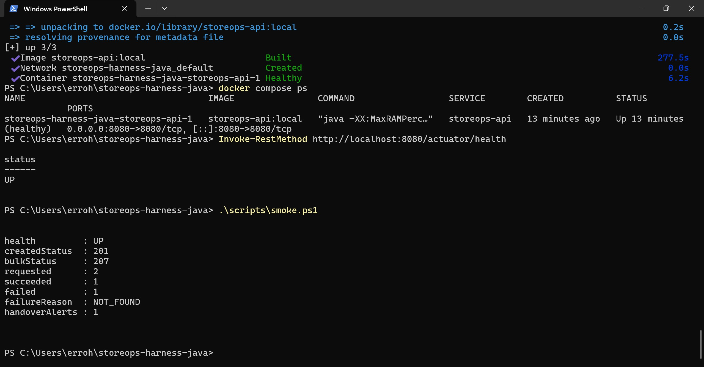

# Local build and HTTP smoke record

- **Date:** 2026-10-12
- **Host:** Windows PowerShell
- **Runtime:** Temurin JDK 17.0.20.1+1, Maven Wrapper 3.9.16
- **Application:** StoreOps packaged Spring Boot JAR

## Clean build

From the repository root, the final verification used the Maven wrapper with the `harness-gates` profile and a temporary local Maven dependency cache. With JDK 17 installed, the equivalent command for a fresh checkout is:

```powershell
.\mvnw.cmd -B -ntp clean verify -Pharness-gates
```

The final run reported `BUILD SUCCESS`, 146 tests with zero failures, errors, or skips, nine passing `ArchitectureRulesTest` cases, zero SpotBugs findings, and all JaCoCo coverage checks met. Both Checkstyle gate executions completed successfully. The first clean run had 145 passing tests but failed the SpotBugs gate on seven mutable-list exposure findings; defensive copying was added before the final clean run. Raw logs are retained locally as `.harness/output/verify-first-failed.log` and `.harness/output/verify.log`. That output directory is ignored by Git, so the command above is the reproducible check for a fresh checkout.

## Live HTTP check

The app was started from a packaged JAR on `http://localhost:18080` with environment-configured outgoing and incoming department leads. No token values are recorded here. The PowerShell smoke script performed the health request, created an activity, submitted that ID plus a generated missing ID to `PATCH /api/activities/bulk-status`, and read the incoming lead's alerts:

```powershell
.\scripts\smoke.ps1 -BaseUrl http://localhost:18080
```

Observed output from the live JAR run:

```text
health          : UP
createdStatus   : 201
bulkStatus      : 207
requested       : 2
succeeded       : 1
failed          : 1
failureReason   : NOT_FOUND
handoverAlerts  : 1
```

The script checks that the successful item ID matches the created activity, the failed item ID matches the missing activity, and the alert has type `SHIFT_HANDOVER`, channel `IN_APP`, and the configured incoming lead and store. These results verify one local process and one mixed-result request; they do not establish multi-instance persistence or production readiness.

## Docker Desktop deployment (personal laptop)

The repository was cloned onto a separate Windows laptop with Docker Desktop and its Linux engine. From the repository root, the container image was built and started with:

```powershell
docker compose up --build --wait --wait-timeout 300
docker compose ps
Invoke-RestMethod http://localhost:8080/actuator/health
.\scripts\smoke.ps1
```

The captured terminal shows image `storeops-api:local` built, the `storeops-api` container healthy on port 8080, and the health endpoint returning `UP`. The smoke script reported `createdStatus: 201`, `bulkStatus: 207`, two requested updates with one success and one `NOT_FOUND` failure, and one incoming-lead handover alert.



This is local Docker deployment and API evidence. It does not establish a public cloud deployment, multi-instance persistence, or production readiness.
